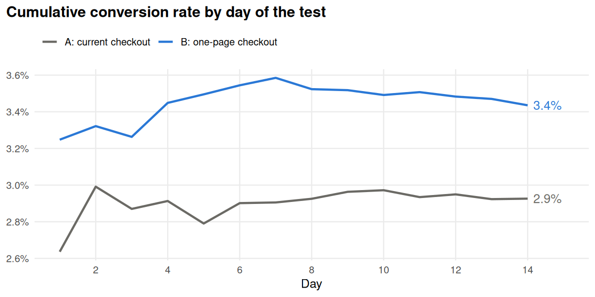
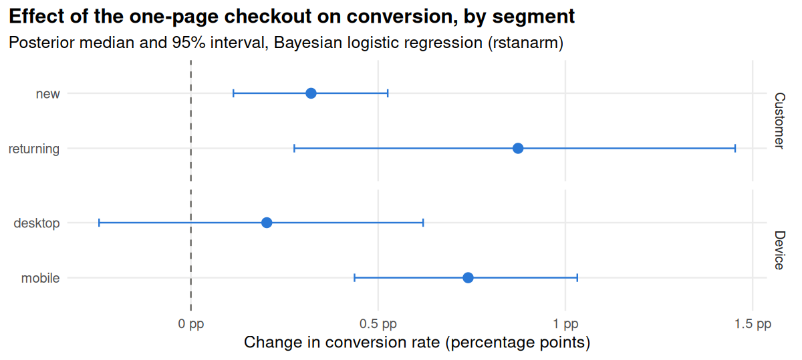

# Checkout A/B Test (R)

[](https://github.com/mhmmdhaghjoo/checkout-ab-test-r/actions/workflows/ci.yml)

**Business question:** should an online shop replace its checkout with a
one-page checkout? This project designs and analyses the A/B test in R, from
the sample-size calculation to a rollout recommendation in euros. The full
decision memo is [`reports/report.md`](reports/report.md); it is re-rendered
from the code on every push.



## Result in short

80,000 visitors, 14 days, randomised 50/50 (sample ratio check p = 0.39).

| Metric | A | B | B minus A (95 % interval) |
|---|---:|---:|---:|
| Conversion rate (primary) | 2.93 % | 3.44 % | +0.51 pp (+0.27 to +0.75), p < 0.001 |
| Revenue per visitor | €2.04 | €2.30 | +€0.27 (+€0.08 to +€0.45) |
| Average order value (guardrail) | €69.59 | €66.99 | −€2.60 (−€5.41 to +€0.21) |

- **Recommendation: roll out on mobile, test again on desktop.** A Bayesian
  logistic regression (rstanarm) puts the mobile effect at +0.74 pp
  (+0.44 to +1.03). The desktop interval includes zero (−0.25 to +0.62).
- **The guardrail moved.** The new checkout wins extra buyers with smaller
  baskets, so average order value fell by €2.60. Revenue per visitor still
  rose, but the order value needs watching after rollout.
- **Peeking would have broken the test.** In 2,000 simulated A/A tests,
  reading the result once at the planned end gave 4.5 % false winners.
  Checking daily and stopping at the first p < 0.05 gave 21.8 %.
- **CUPED did not help here, and the report says why.** Using spend from the
  30 days before the test cut the revenue variance by only about 4 %,
  because most visitors are new and have no history.



## Methods

| Step | Function | Method |
|---|---|---|
| Design | `required_sample_size()`, `minimum_detectable_effect()` | Power analysis for two proportions, fixed before the data arrive |
| Trust | `srm_check()` | Chi-square sample ratio mismatch test; balance of device, customer type and pre-test spend |
| Primary metric | `two_proportion_test()` | Difference in conversion with Wald interval and pooled z-test |
| Money metrics | `mean_difference()`, `cuped_adjust()` | Welch t-test on revenue per visitor and order value; CUPED variance reduction |
| Bayesian view | `beta_binomial()`, `segment_effects()` | Beta-binomial probability that B is better and expected loss; Bayesian logistic regression by segment with rstanarm |
| Peeking | `peeking_simulation()` | Monte Carlo of 2,000 A/A tests with daily looks |
| Report | `analysis/report.Rmd` | R Markdown; every number in the text is computed, none typed |

The statistics follow *Introduction to Modern Statistics* (Çetinkaya-Rundel
and Hardin), *Regression and Other Stories* (Gelman, Hill and Vehtari) and
*Statistical Rethinking* (McElreath). The design questions (sample ratio,
peeking, pre-registration of the sample size) connect to the Experimental
Behavioral Research in Data Science course at FAU Erlangen-Nürnberg.

## The data

The visitors are **simulated** in `R/simulate.R` with known effects: the new
checkout raises conversion on mobile, does nothing on desktop, and lowers the
average order value slightly. That makes it possible to check that the
analysis recovers the truth, which the tests do. The numbers are illustrative,
not evidence about a real shop.

## Run it

Requires R 4.1 or later.

```r
install.packages(c("ggplot2", "rstanarm", "rmarkdown", "knitr", "testthat", "lintr"))
testthat::test_dir("tests/testthat")   # 11 tests
source("analysis/run_analysis.R")      # writes reports/
```

CI on GitHub Actions lints the code with lintr, runs the tests, re-runs the
analysis and commits the rendered report.

## Related projects

- [Employee Turnover Analytics](https://github.com/mhmmdhaghjoo/employee-turnover-analytics): people analytics on ten years of HR records
- [Online Retail SQL Warehouse](https://github.com/mhmmdhaghjoo/online-retail-sql-warehouse): raw exports to a tested star schema in PostgreSQL
- [Customer Churn ML Pipeline](https://github.com/mhmmdhaghjoo/customer-churn-ml-pipeline): churn prediction as a tested Python package
- [Text-to-SQL Assistant](https://github.com/mhmmdhaghjoo/text-to-sql-assistant): LLM-written SQL with a read-only guard

More about me: [mhmmdhaghjoo.github.io](https://mhmmdhaghjoo.github.io) and [github.com/mhmmdhaghjoo](https://github.com/mhmmdhaghjoo)

## Licence

MIT

Author: Mohammad Haghjoo
