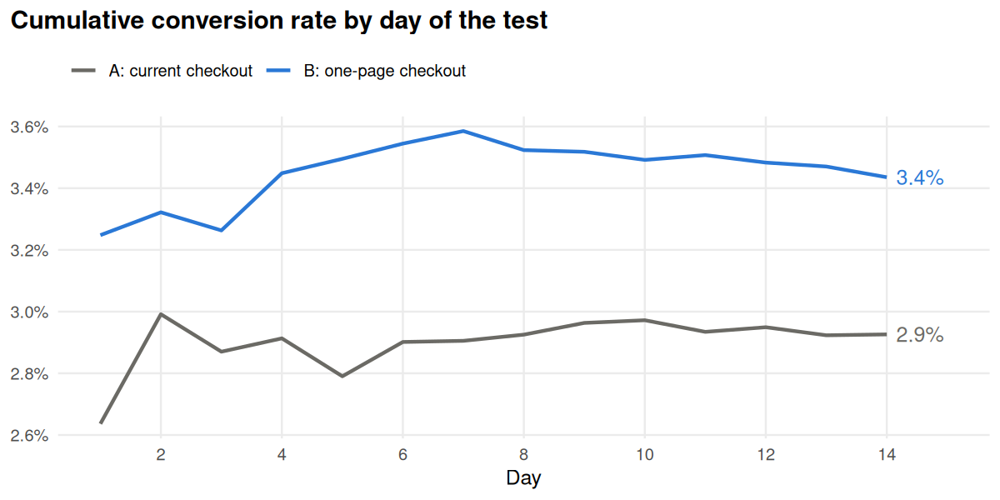
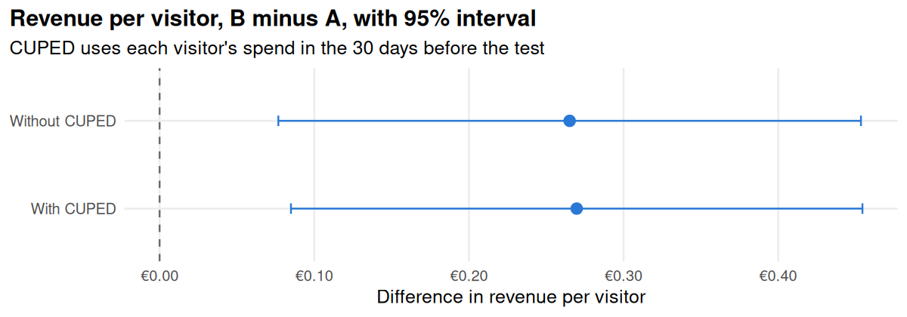
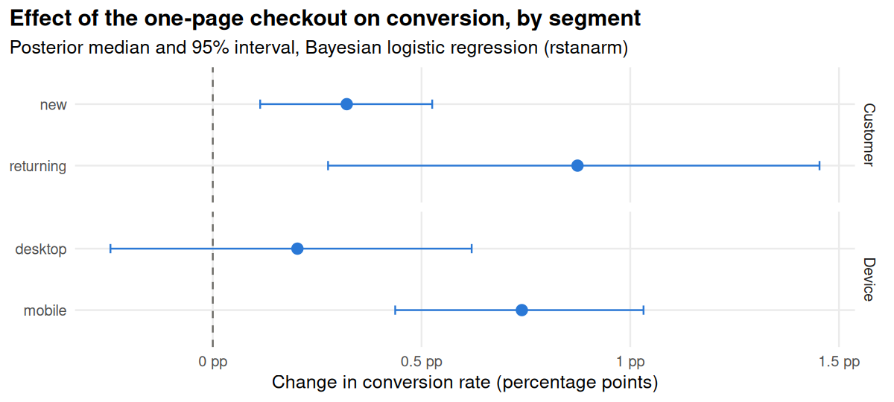
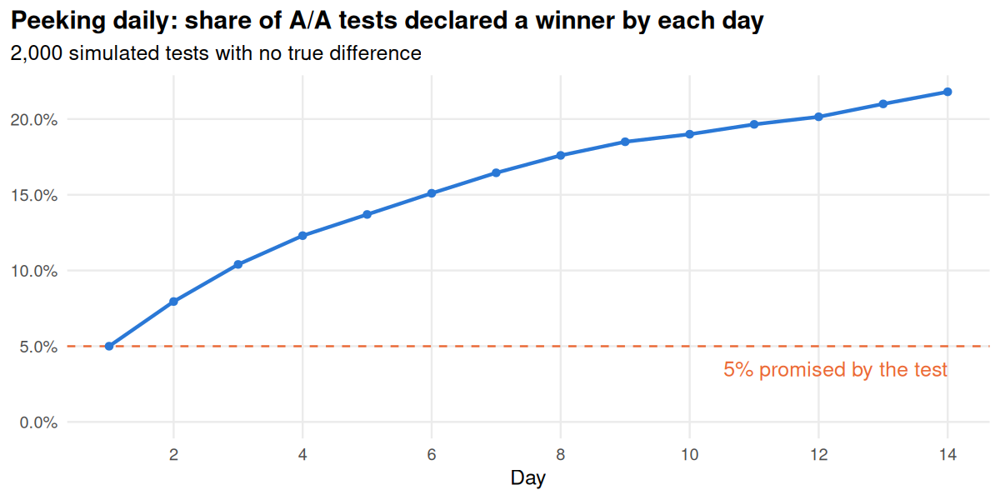

Should we roll out the one-page checkout?
================

## Recommendation

Roll out the one-page checkout **on mobile**, and keep the current
checkout on desktop until a desktop test shows a benefit. On mobile,
conversion rose by 0.74 pp (95% interval 0.44 pp to 1.03 pp). On desktop
the effect is indistinguishable from zero.

## The test

The test compared the current checkout (A) with a one-page checkout (B).
It ran for 14 days with 80,000 visitors split 50/50 at random. Before
the start, a power analysis fixed the sample size: detecting a lift of
0.35 pp from a 3.0% baseline with 80% power needs 39,394 visitors per
arm.

**Can the data be trusted?** The split was 40,122 to 39,878 (sample
ratio check p = 0.388, so randomisation worked). Device mix, customer
mix and pre-test spend are balanced across arms.

## Results

| Metric | A | B | B minus A (95% interval) | p-value |
|----|---:|---:|---:|---:|
| Conversion rate (primary) | 2.93% | 3.44% | 0.51 pp (0.27 pp to 0.75 pp) | 4e-05 |
| Revenue per visitor | €2.04 | €2.30 | €0.27 (€0.08 to €0.45) | 0.0058 |
| Revenue per visitor, CUPED |  |  | €0.27 (€0.08 to €0.45) | 0.0042 |
| Average order value (guardrail) | €69.59 | €66.99 | −€2.60 (−€5.41 to €0.21) | 0.07 |

Conversion rose by 17.4% relative to A. The Bayesian model puts the
probability that B converts better at more than 99.9%. The expected loss
from choosing B (the conversion given up if B is in fact worse, weighted
by how likely that is) is below 0.001 pp, so the risk of rolling it out
is negligible.

Buyers in B spend €2.60 less per order (p = 0.070, so this guardrail
needs watching after rollout). The checkout wins extra buyers with
smaller baskets, and revenue per visitor still rises.

Adjusting for each visitor’s spend in the 30 days before the test
(CUPED) reduced the variance by only 4% here. Most visitors are new and
spent nothing before, so past spend predicts little of two weeks’
revenue. CUPED pays off when a strong pre-period metric exists, for
example visits or sessions for an engagement metric.

## Where the effect comes from

A Bayesian logistic regression (rstanarm) estimates the effect
separately for each segment. On mobile the effect is clearly positive
(probability more than 99.9% that it is above zero). On desktop the
interval spans zero (-0.25 pp to 0.62 pp).

## Why the test ran its full length

In 2,000 simulated tests with no true difference, looking once at the
planned end declared a false winner 4.5% of the time, as promised.
Looking every day and stopping at the first p \< 0.05 declared a false
winner 21.8% of the time. The test was therefore read once, after 14
days.

## What it is worth

At about 171,420 visitors a month, of whom 60% are on mobile, the mobile
revenue gain of €0.44 per visitor is worth roughly €44,658 a month (95%
interval €22,069 to €67,246).

## Caveats

- The data are simulated with known effects, so the analysis can be
  checked against the truth; the effect sizes are illustrative.
- The segment comparison is exploratory. Desktop should get its own,
  properly powered test before any rollout there.
- Two weeks cannot show long-term effects such as repeat purchases or
  returns.
